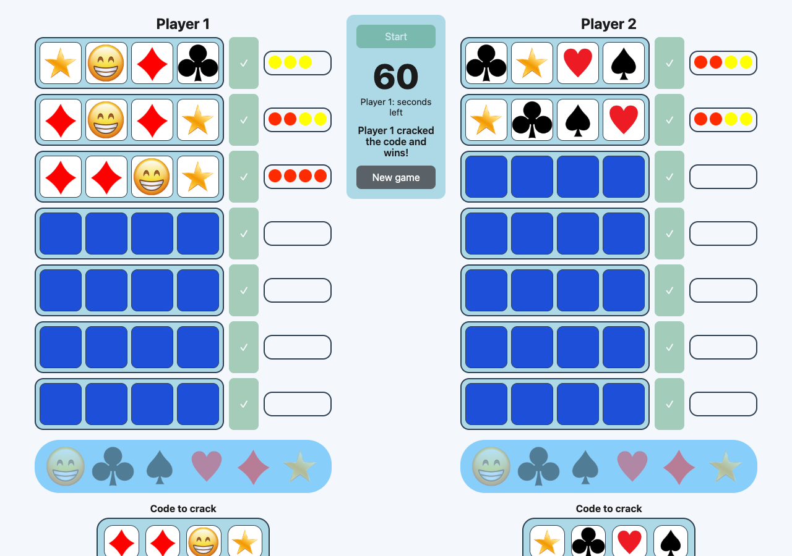
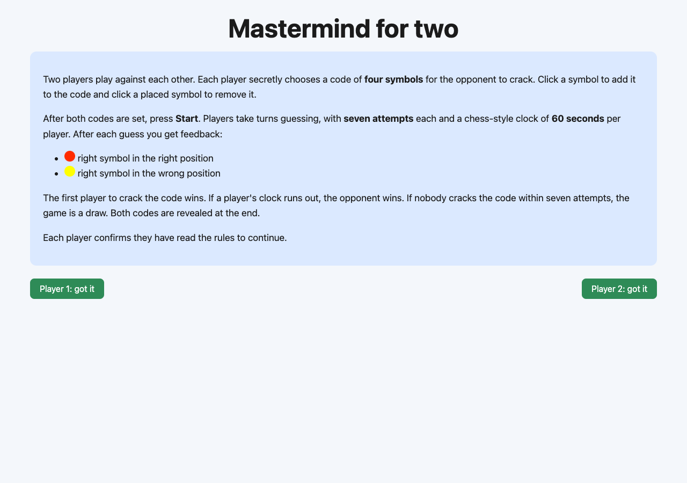
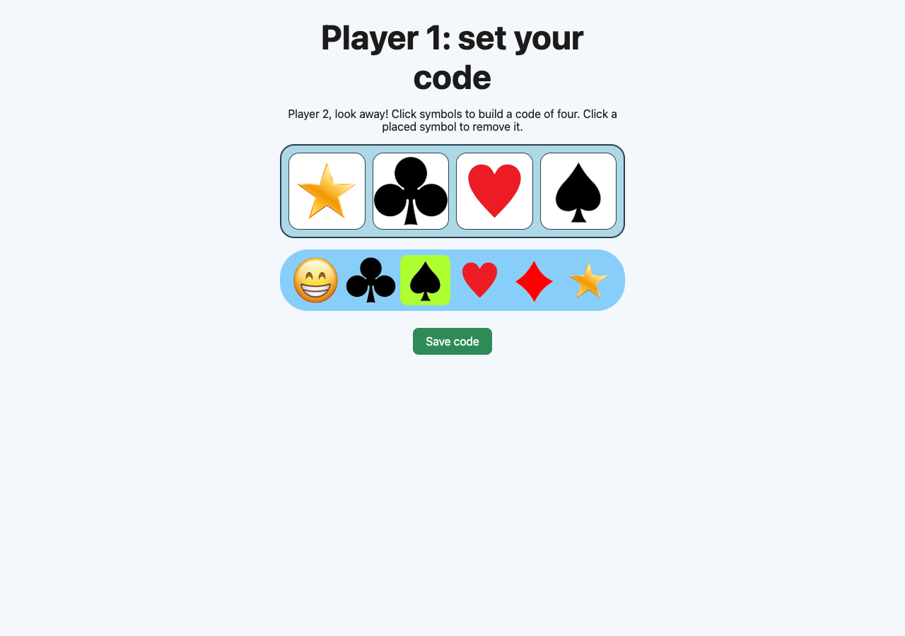

# Mastermind for two

[](https://github.com/FansteLK/Mastermind-game/actions/workflows/ci.yml)

A two-player, head-to-head take on the classic code-breaking game, built with plain HTML, CSS and JavaScript (no frameworks, no build step).

**▶ Play it: https://fanstelk.github.io/Mastermind-game/**



## How it plays

1. **Rules.** Both players confirm they have read the rules.
2. **Set codes.** Each player secretly picks a four-symbol code from six symbols for the opponent to crack.
3. **Guess.** Players alternate guesses, with seven attempts each and a chess-style clock that gives each player 60 seconds in total.
   - 🔴 red peg: right symbol, right position
   - 🟡 yellow peg: right symbol, wrong position
4. **Win** by cracking the code first. If your clock runs out, you lose. If nobody cracks the code in seven attempts, it's a draw.

| Rules | Setting a code |
| --- | --- |
|  |  |

## Project structure

```
index.html        rules screen
setup.html        each player sets a secret code
game.html         the game board
js/scoring.js     pure game rules (scoring, validation), shared by browser and tests
js/ui.js          DOM helpers for code slots, symbol palette and session storage
js/setup.js       setup screen logic
js/game.js        turn order, chess clock, win/draw detection
tests/            Node test suite for the scoring rules
```

The scoring function counts exact matches first and then matches misplaced symbols against the remaining multiset of the secret. This handles duplicate symbols correctly: for example, guessing three ★ against a secret with a single ★ earns only one peg.

## Running locally

Open `index.html` in a browser, or serve the folder:

```bash
npm start          # serves on http://localhost:3000
npm test           # runs the scoring tests (Node 18+)
```

## Background

Originally built as a university web programming assignment (jQuery + Bootstrap), with the UI in Serbian. The game is inspired by *Skočko*, the Mastermind round from the Serbian TV quiz *Slagalica*. It was later rewritten in dependency-free JavaScript, with English UI, unit-tested scoring, fixes for the draw and timer edge cases, and CI/CD to GitHub Pages.
